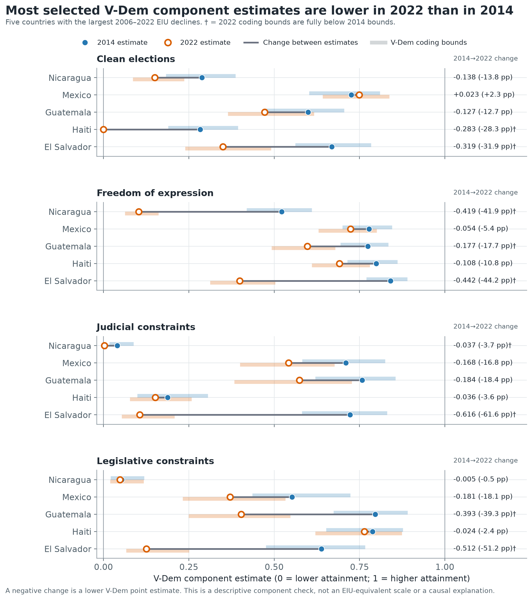

# Concentrated EIU declines coincided with broad, but uneven, institutional weakening

The five countries with the largest 2006–2022 EIU democracy-score declines in the selected 12-country North American comparison group, Nicaragua, Mexico, Guatemala, Haiti, and El Salvador, account for 8.53 of the group’s net 10.66-point decline, or about 80%. This makes them a meaningful set of cases for examining what accompanied the broader decline in this comparison group instead of a selection of dramatic examples.

Across these five cases, V-Dem’s 2014–2022 point estimates declined in 19 of 20 country-component comparisons covering clean elections, freedom of expression, judicial constraints on the executive, and legislative constraints on the executive. This pattern is consistent with the large EIU declines occurring alongside weakening in several institutional dimensions of democracy. However, it is not a uniform pattern, as the size of the estimated change differs across countries and components: only 9 of the 20 comparisons show a clear change because the two years’ plausible value ranges do not overlap, and Mexico’s clean-elections estimate increased slightly, by 0.023. Mexico's counterexample means that we should not read an EIU decline as evidence that every democratic institution weakened.

The matched-year correlation check reinforces this cautious reading. EIU and V-Dem levels are positively associated across the selected country-years, especially for clean elections and judicial constraints, but the correlations of year-to-year changes are modest. Put simply, the two measures tend to place stronger and weaker country-years in similar positions overall, but they do not reliably move together from one year to the next.

Our analysis does not show that V-Dem components caused EIU scores to fall. EIU and V-Dem are both expert-coded projects that assess related democratic concepts using much of the same public political record, so it's possible that their agreement may partly reflect overlapping measurement judgments instead of independent confirmation. We also limited our analysis to five high-decline cases and a selected comparison group which means we cannot establish, therefore, that the same pattern applies to all countries or all forms of democratic decline.